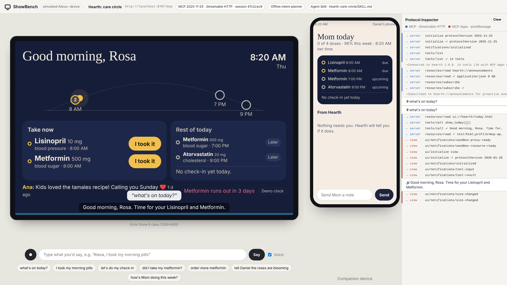
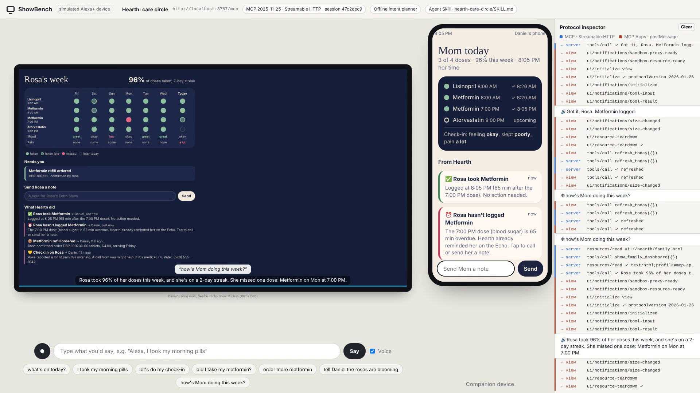
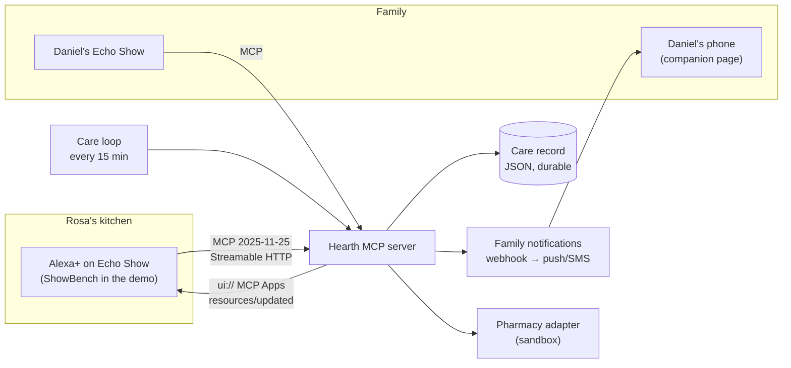

# Hearth: a care circle for Alexa+

**Hearth lets an older adult manage her medications and daily check-ins by voice on an Echo Show, and keeps her family in the loop from wherever they live.** It is a self-hosted **MCP server** (spec **2025-11-25**, **Streamable HTTP**) with **MCP Apps** visual cards, **proactive announcements** over resource subscriptions, a **purchase flow** with explicit confirmation, and an **Agent Skill** that carries the care rules.

> Built for the *Build, Ship, Shape: Amazon Developer Hackathon* (Alexa+ track, Open Source mini challenge).
> Demo video: **https://youtu.be/INpCtqBra5s** · Simulator: [ShowBench](https://github.com/acirema792/showbench) (open source, built alongside Hearth)



### For judges: test it in 3 minutes

```bash
git clone https://github.com/acirema792/hearth-alexa && cd hearth-alexa && npm install
npm test            # 9 end-to-end tests over real Streamable HTTP (~5 s)
npm start           # MCP server → http://127.0.0.1:8787/mcp
# in a second terminal, from the same folder:
npx github:acirema792/showbench --server http://localhost:8787/mcp --intents showbench.intents.json \
  --skill skills/hearth-care-circle/SKILL.md --companion http://localhost:8787/companion
# open http://localhost:5173 and click the suggestion chips, then:
curl -X POST localhost:8787/demo/clock -H 'content-type: application/json' -d '{"set":"19:35"}'   # the Echo speaks up on its own
```

No API keys, accounts or hardware needed. Node 20+ only.

## Why

- In 2025 Amazon retired **Alexa Together**, its paid remote-caregiving service ([Amazon](https://www.aboutamazon.com/news/devices/alexa-together-is-helping-bridge-the-miles-between-families)). The need didn't go away.
- **63 million Americans** are family caregivers, up 45% in a decade ([AARP & NAC, *Caregiving in the US 2025*](https://www.aarp.org/caregiving/basics/caregiving-in-us-survey-2025/)). Many care from another city.
- **Half of the 3.2 billion US prescriptions are not taken as prescribed**, at an estimated **$100–300 billion a year**, and poor adherence drives 33–69% of medication-related hospital admissions ([Bosworth et al., *American Heart Journal*, 2011](https://pmc.ncbi.nlm.nih.gov/articles/PMC3947508/)).

- **Someone already pays for adherence.** Medicare Part D Star Ratings score plans on adherence to exactly Rosa's three drug classes: diabetes medications, RAS antagonists (lisinopril) and statins. Each measure is triple-weighted ([AJMC](https://ajmc.com/view/contributor-medication-adherence-is-a-force-multiplier-for-medicare-advantage-profitability-enrollment-star-ratings)). That gives Hearth a credible route to market: **free for families, sponsored by Medicare Advantage plans and pharmacies**, which could also ship it as their own branded Alexa+ experience.

The Echo Show is already in the kitchens of the people who need this most. Alexa+ can finally hold a real conversation. Hearth is the care brain behind it.

## What it does

**For Rosa (78, lives alone, Echo Show in the kitchen)**
- *"Alexa, I took my morning pills."* Logs every dose due, updates her streak, tells her what's next.
- *"Did I take my metformin? I can't remember."* Answers from the record, never logs, and tells her **not** to take another one. A **double-dose guard** is enforced in the server, not just in a prompt.
- *"Let's do my check-in."* Three big-button questions (mood, sleep, pain), one at a time.
- *"Order more metformin."* Quote → read-back → explicit *yes* → order. Tokens expire after 15 minutes.
- Unprompted: *"Rosa, it's time for your blood sugar pill."* and *"Daniel sent you a message…"*

**For Daniel (son, Seattle) and Ana (daughter, Chicago)**
- Push/SMS when something needs them, following an **escalation ladder**: reminder on the Echo at +30 min, primary caregiver at +60 min, the whole circle at +120 min. Family **quiet hours** are respected for non-urgent alerts.
- **Closed loops**: when Rosa takes a late dose, everyone Hearth worried gets *"✅ Rosa took Metformin. No action needed."*
- A **family dashboard** (MCP App): 7-day adherence grid, mood/sleep/pain trend, refills to confirm, and a note box that speaks on Mom's Echo.
- *"Alexa, how's Mom doing this week?"* gives a spoken summary.



**On its own (the care loop)**
`run_care_rounds` runs every 15 minutes, like an Alexa+ routine. It checks every dose and the daily check-in against the ladder, forecasts refills (quotes one when supply drops under 5 days), and is **idempotent**: every step has a dedupe key, so nobody gets texted twice.

## How it uses the Alexa+ stack

| Capability | Where |
|---|---|
| **MCP 2025-11-25 over Streamable HTTP**, stateful sessions, Origin validation, CORS for browser hosts | [`src/index.ts`](src/index.ts) |
| **14 tools** with `readOnlyHint` / `idempotentHint` / `openWorldHint` annotations and Zod input schemas | [`src/tools.ts`](src/tools.ts) |
| **MCP Apps** (`io.modelcontextprotocol/ui`): 4 `ui://` views (`text/html;profile=mcp-app`), bundled to single files | [`views/src`](views/src) |
| App-only tools (`visibility: ["app"]`) so views refresh themselves without polluting the model's tool list | `refresh_today`, `refresh_family` |
| Views call tools (`tools/call`), push context back to the assistant (`ui/update-model-context`), handle `ui/resource-teardown` | [`views/src/today.ts`](views/src/today.ts) |
| **Proactive speech**: `resources/subscribe` on `hearth://announcements` + `notifications/resources/updated` over the standalone SSE stream | [`src/tools.ts`](src/tools.ts) |
| Server `instructions`, a `hearth://care-plan` resource, and 2 prompts (`morning_routine`, `caregiver_briefing`) | [`src/tools.ts`](src/tools.ts) |
| **Agent Skill** ([agentskills.io](https://agentskills.io) format) with voice rules, safety rules and worked examples, loaded into the agent at runtime | [`skills/hearth-care-circle/SKILL.md`](skills/hearth-care-circle/SKILL.md) |
| Purchasing with explicit confirmation (quote token → confirm), sandbox pharmacy adapter | [`src/care.ts`](src/care.ts), [`src/services.ts`](src/services.ts) |
| Cross-service orchestration: family notifications via webhook (n8n, Zapier, ntfy, SMS gateways), pharmacy, durable care record | [`src/services.ts`](src/services.ts) |



## Run it (2 minutes)

Requires Node 20+.

```bash
git clone https://github.com/acirema792/hearth-alexa && cd hearth-alexa
npm install
npm start                      # MCP server on http://127.0.0.1:8787/mcp + family app on /companion
```

Then open the device simulator in another terminal:

```bash
npx github:acirema792/showbench \
  --server http://localhost:8787/mcp \
  --intents showbench.intents.json \
  --skill skills/hearth-care-circle/SKILL.md \
  --companion http://localhost:8787/companion \
  --device-label "Rosa's kitchen" --companion-label "Daniel's phone"
# open http://localhost:5173
```

ShowBench runs offline with Hearth's intent rules out of the box. The demo video uses this deterministic planner so it is exactly reproducible. For a real LLM planner, set `ANTHROPIC_API_KEY`, or `OPENAI_API_KEY` (+ `OPENAI_BASE_URL` for Gemini, Groq, OpenRouter or Ollama). The planner then uses Hearth's server instructions and Agent Skill.

**Try:** "what's on today?", "I took my morning pills", "let's do my check-in", "did I take my metformin?", "order more metformin" → "yes", "tell Daniel the roses are blooming".

**Jump the clock** to see escalation and proactive announcements:

```bash
curl -X POST localhost:8787/demo/clock -H 'content-type: application/json' -d '{"set":"19:35"}'   # Echo reminds Rosa
curl -X POST localhost:8787/demo/clock -H 'content-type: application/json' -d '{"set":"20:05"}'   # Daniel's phone buzzes
curl -X POST localhost:8787/demo/reset -H 'content-type: application/json' -d '{"set":"08:20"}'   # fresh morning
```

**Docker (self-hosting).** `docker build -t hearth . && docker run -p 8787:8787 -v hearth-data:/app/data hearth`

**Other MCP hosts.** Any MCP-Apps-capable host can use Hearth: Claude, VS Code, Goose, MCPJam and others. Point it at `http://<host>:8787/mcp`. For a remote host, expose it with a tunnel (for example `cloudflared tunnel --url http://localhost:8787`) and set `HOST=0.0.0.0` and `HEARTH_ALLOWED_ORIGINS`.

## Tools

| Tool | Who | What |
|---|---|---|
| `show_today` (UI) | Rosa | Her day: doses on a sun-arc timeline, check-in, messages, low supplies |
| `log_medication` (UI) | Rosa | Log taken/skipped by name, purpose or group ("morning pills"); double-dose guard; closes the loop with worried family |
| `check_medication` | Rosa | "Did I take…?": read-only, safe wording |
| `start_check_in` (UI) / `record_check_in` | Rosa | Mood, sleep, pain; gentle flags to the primary caregiver |
| `quote_refill` (UI) / `confirm_refill` (UI) | Rosa or family | Purchase flow with explicit confirmation and expiring token |
| `send_family_message` / `read_family_messages` | Everyone | Notes that arrive as push/SMS, or are spoken on her Echo |
| `run_care_rounds` | Routine | Escalation ladder, check-in nudges, refill forecasting; idempotent |
| `show_family_dashboard` (UI) / `get_care_summary` | Family | 7-day adherence, trends, alerts, one-tap refill confirm |
| `refresh_today`, `refresh_family` | Views only | `visibility: ["app"]` live refresh |

## Safety and privacy by design

- **No medical advice.** The rule is in the server instructions, in tool descriptions, in the Agent Skill, and in code paths that return safe wording. Pain or low mood triggers *"a call might help"*, never a diagnosis.
- **Emergencies first.** The skill tells the assistant to direct chest pain, falls, breathing trouble or confusion to 911 or emergency calling before anything else.
- **Purchases need a yes.** Quote tokens are single-use and expire.
- **Uncertain questions never write.** `check_medication` is read-only.
- **Minimal data.** It stores medication schedule, logs, check-ins and messages only. No audio is stored.
- Demo safety: the pharmacy is a clearly labelled **sandbox**. Demo clock endpoints can be turned off with `HEARTH_DEMO=0`.

## Tests

```bash
npm test     # 9 end-to-end tests: real server, real MCP client, real Streamable HTTP
```

The tests cover:
- protocol negotiation (2025-11-25)
- MCP Apps metadata
- the morning flow and the double-dose guard
- the pain flag
- the escalation ladder and its idempotency
- the purchase flow
- cross-session persistence
- proactive `resources/updated` push
- read-only `check_medication`

## Configuration

| Env | Default | |
|---|---|---|
| `PORT` / `HOST` | `8787` / `127.0.0.1` | Listen address |
| `HEARTH_DATA` | `data/hearth.json` | Care record (seeded with a demo household on first run) |
| `HEARTH_WEBHOOK_URL` | – | POST every family notification as JSON (n8n, Zapier, ntfy, Slack, SMS gateway) |
| `HEARTH_ROUNDS_INTERVAL_SEC` | `60` | Autonomous care-loop interval (0 = off) |
| `HEARTH_ALLOWED_ORIGINS` | localhost | Extra browser origins allowed to connect |
| `HEARTH_DEMO` | `1` | Demo clock endpoints |

## Project layout

```
src/        index.ts (HTTP + sessions) · tools.ts (MCP surface) · care.ts (care engine) · services.ts (notify, pharmacy) · clock.ts · model.ts (types + seed)
views/src/  MCP Apps views: today, checkin, refill, family (vanilla TS, bundled by esbuild into single HTML files)
companion/  Daniel's phone: live family feed over SSE
skills/     Agent Skill: hearth-care-circle
test/       end-to-end tests
docs/       product feedback, friction log, feature requests
```

## Built during the hackathon

Everything in this repository and in ShowBench was written during the submission window (Oct 2026); see the commit history.

## Roadmap

- Alexa+ account linking (OAuth) and per-speaker identity (Rosa vs a visiting caregiver).
- Real pharmacy integrations behind the existing adapter interface.
- Ring: a front-door "Rosa went out for her walk" activity signal as a gentle check-in input.
- Fire TV: the evening reminder as a picture-in-picture card during her shows.
- Spanish voice and UI (Rosa's first language).

## License

MIT. See [LICENSE](LICENSE).
